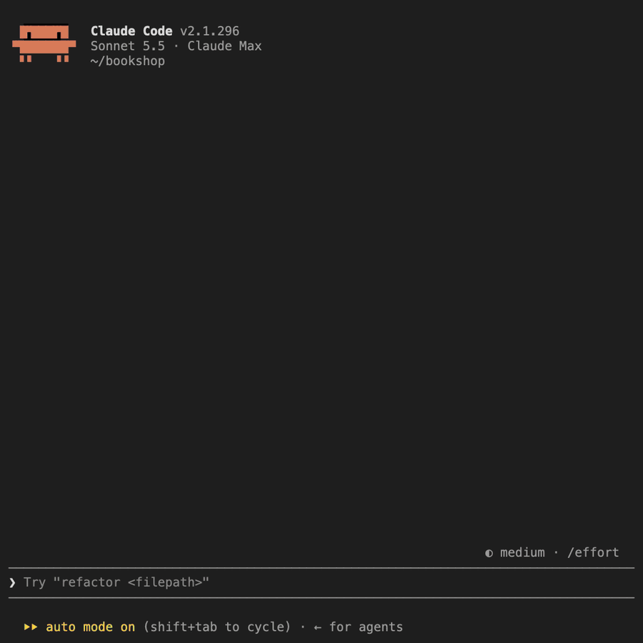

# cc-extensions

Mods for the Claude Code terminal. Each mod works on its own, so install only the ones that you
want.

- [`cleaner-tool-lines`](#cleaner-tool-lines): one line for each tool call
- [`restyled-chat`](#restyled-chat): color themes and full-width code blocks

## Get started

Add this repository as a plugin marketplace:

```sh
claude plugin marketplace add macwilk/cc-extensions
```

Then install a mod with the command in its section. In a Claude Code session that is already open,
run `/reload-plugins` afterward.

## cleaner-tool-lines

Draws each tool call as one line, so the conversation reads straight through. Click a line to open
the call.



```sh
claude plugin install cleaner-tool-lines@cc-extensions
```

The mod needs the fullscreen interface. For that setting, and for what the dot and the note on a
line mean, see the [`cleaner-tool-lines` README](cleaner-tool-lines/README.md).

## restyled-chat

Adds color themes, and draws each code block in a reply as one full-width shaded block.

<p>
  
  
</p>

```sh
claude plugin install restyled-chat@cc-extensions
```

For a preview of every theme, and for how to add one, see the
[`restyled-chat` README](restyled-chat/README.md).

## Check a change

Run the following commands from the root of the repository. Replace `MOD` with the directory of the
mod that you changed.

```sh
claude plugin validate MOD
claude plugin test MOD
npx -p typescript tsc -p MOD
```

The `tsc` command reads type declarations from `MOD/.claude-plugin/types`. Claude Code writes that
directory each time it loads the mod by path, for example when you run
`claude --plugin-dir ./cleaner-tool-lines`.

After you change a palette or the theme builder, also run the following command:

```sh
python3 restyled-chat/scripts/build_theme.py --check restyled-chat/palettes restyled-chat/themes
```

## Credit

The idea of one line for each tool call, and the idea of restyling replies, come from
[Tickloop/claude-mods](https://github.com/Tickloop/claude-mods).

The theme colors come from [Catppuccin](https://catppuccin.com), [Dracula](https://draculatheme.com),
the [GitHub theme](https://github.com/primer/github-vscode-theme) for VS Code,
[Gruvbox](https://github.com/morhetz/gruvbox), [Noctis](https://github.com/liviuschera/noctis),
[Nord](https://www.nordtheme.com), [One Dark Pro](https://github.com/Binaryify/OneDark-Pro),
[Solarized](https://ethanschoonover.com/solarized/),
[Tokyo Night](https://github.com/tokyo-night/tokyo-night-vscode-theme), and the
[Dark Modern](https://github.com/microsoft/vscode/tree/main/extensions/theme-defaults) and
[Monokai](https://github.com/microsoft/vscode/tree/main/extensions/theme-monokai) themes of VS Code.
