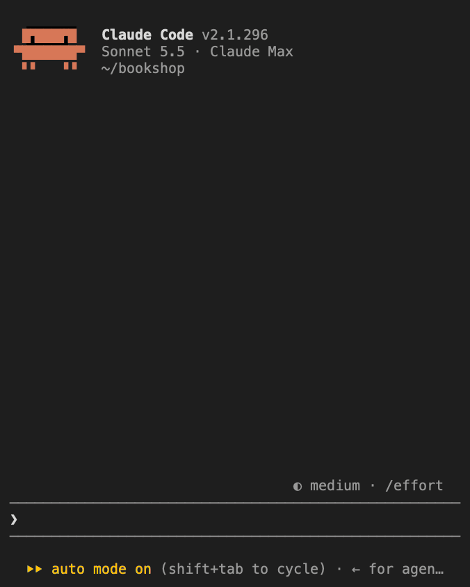
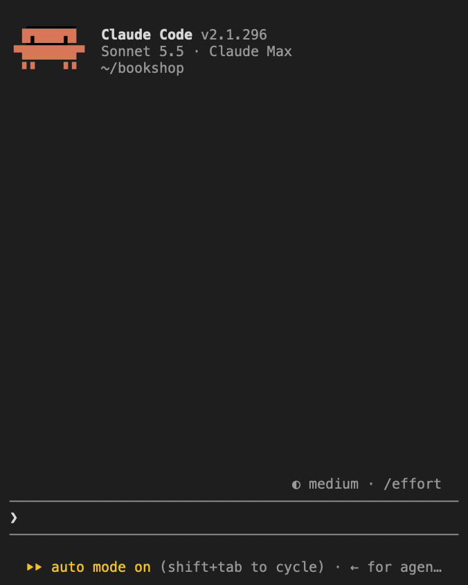

# cleaner-tool-lines

The `cleaner-tool-lines` mod replaces the row and the result block of each tool call in the Claude
Code terminal transcript with one line, so the conversation reads straight through:

```text
● ▸ tool_call: Read(…/src/app/main.py)
● ▸ tool_call: Bash(npm test) - error
```

<p>
  
  
  
</p>

From left to right: the default, **Show the running tool call** turned off, and **Collapse tool
calls** turned off. The [settings](#choose-how-much-a-run-shows) are described below.

The dot shows how the call stands:

- **Yellow:** the call is waiting or running.
- **Green:** the call finished.
- **Red:** the call failed or was interrupted.

A long argument is cut to fit one row. A file path keeps its end, where the file name is.

Click a line to open that call. A shaded panel under the line shows the whole argument of the call,
followed by the result. A shell command appears as highlighted code with its line breaks. To close
the call, click its first row again. When you hold the pointer over a line, only that line is
highlighted.

In the full transcript (<kbd>Control+O</kbd>) and under `claude --verbose`, Claude Code draws every
tool call itself.

The mod takes its colors from your Claude Code theme and needs no other mod.

## Choose how much a run shows

Claude often makes several tool calls in a row before it writes again. The mod folds such a run into
one line, whichever tools the calls use. While Claude is still making calls, the line shows the
latest one:

```text
● ▸ 4 tool_calls: Edit(…/src/app/main.py)
```

When Claude writes again, when a prompt that you typed while it worked reaches it, or when the turn
ends, the line counts the calls by tool:

```text
● ▸ 6 tool_calls: 3 Bash, 1 Write, 1 Edit, 1 mcp__inbox__inbox - 1 failed
```

Click the line of a run to list its calls, each on a line that you can open. Click the line again to
fold the run. A call with no other call next to it keeps its own line.

Two settings change this. To set one, run `/config` and search for its name:

- **Collapse tool calls:** turn it off to give every call its own line.
- **Show the running tool call:** turn it off to have the line count the calls by tool while Claude
  is still making them, too.
- **Gray out closed tool calls:** turn it on to have the line grayed out when collapsed, which makes it stand out less. 

## Before you begin

Set `"tui": "fullscreen"` in your Claude Code settings. Claude Code reports clicks only in the
fullscreen interface.

## Install the mod

```sh
claude plugin marketplace add macwilk/cc-extensions
claude plugin install cleaner-tool-lines@cc-extensions
```

In a Claude Code session that is already open, run `/reload-plugins`.

To receive new versions, run `/plugin`, go to the **Marketplaces** tab, select `cc-extensions`, and
then select **Enable auto-update**. Claude Code leaves auto-update off for this marketplace.
