# restyled-chat

The `restyled-chat` mod changes how the Claude Code terminal looks:

- It adds color themes.
- It draws each fenced code block in a reply as one full-width shaded block. The first row of the
  block shows the language and a **copy** button.
- It colors the code in a block as VS Code colors it under the same theme, and a `diff` block from
  the diff colors of the theme.

<p>
  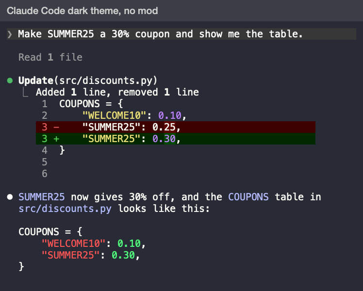
  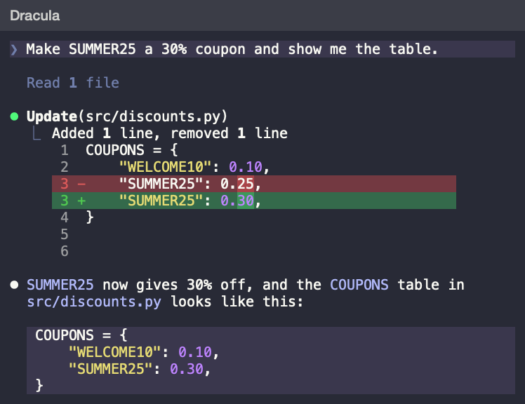
</p>

## Themes

Each preview shows the same conversation.

<p>
  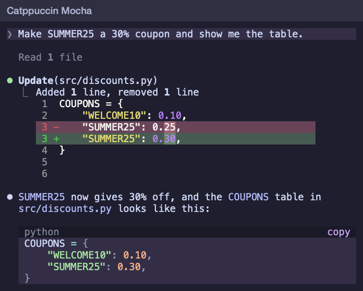
  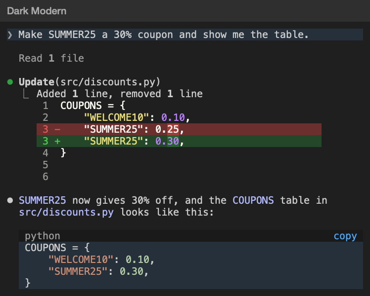
  
  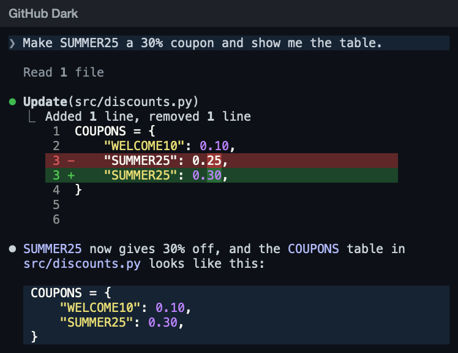
  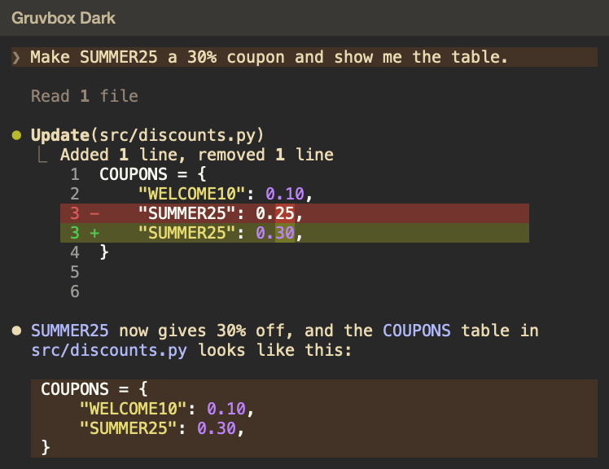
  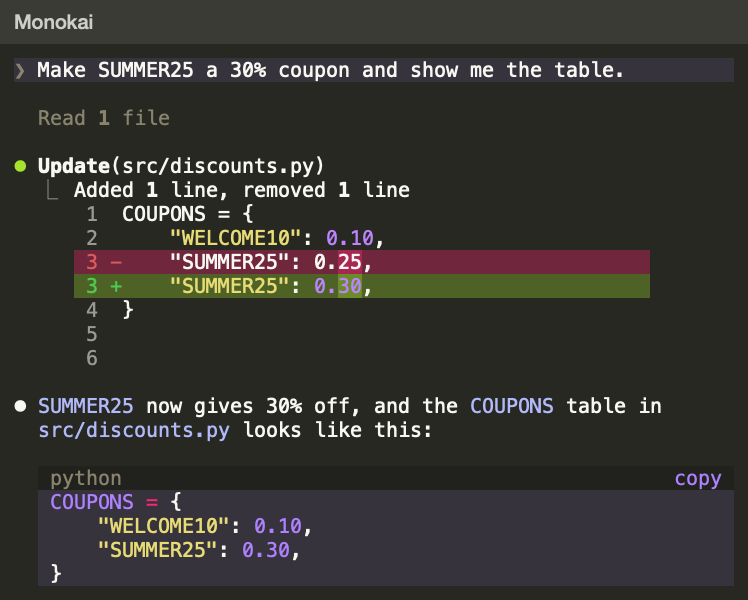
  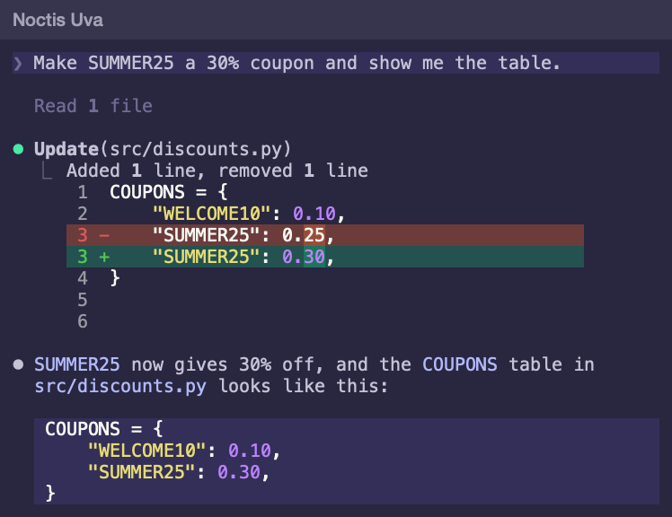
  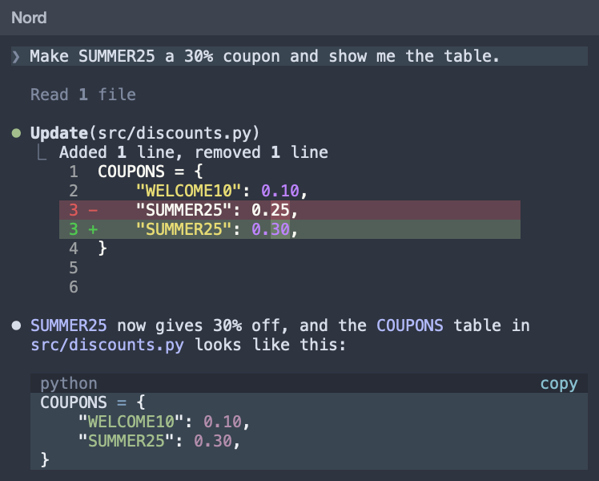
  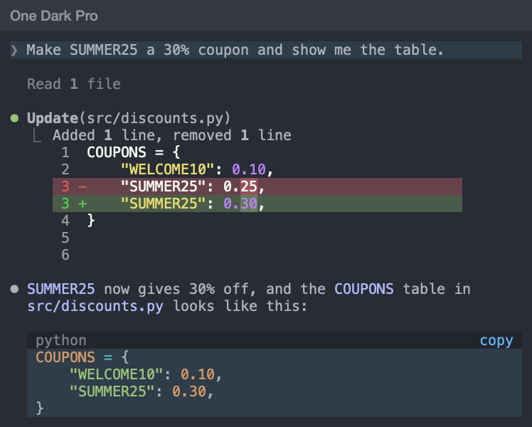
  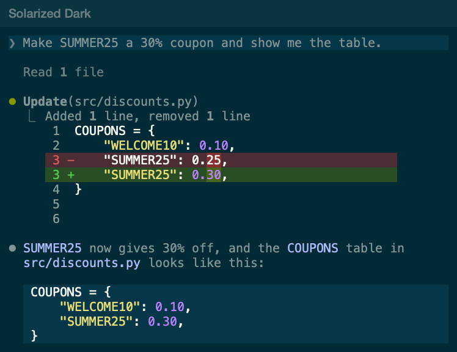
  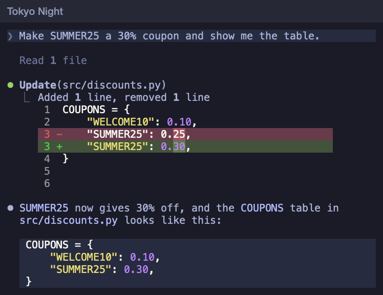
</p>

## Code colors

The mod colors code with [Shiki](https://shiki.style), which uses the grammars and the theme files
of VS Code. Code takes the colors and the font styles that VS Code gives it under the theme of the
same name.

Code keeps the colors of Claude Code in the following cases:

- Shiki has no grammar for the language. Shiki has grammars for more than 200 languages.
- Shiki has no theme of the same name as the Claude Code theme, for example under a built-in theme
  of Claude Code.
- The block is too long to draw line by line.

The mod reads a grammar or a theme from its `shiki` directory the first time that a reply needs it.

## Install the mod

```sh
claude plugin marketplace add macwilk/cc-extensions
claude plugin install restyled-chat@cc-extensions
```

In a Claude Code session that is already open, run `/reload-plugins`.

To receive new versions, run `/plugin`, go to the **Marketplaces** tab, select `cc-extensions`, and
then select **Enable auto-update**. Claude Code leaves auto-update off for this marketplace.

## Turn on a theme

1. In Claude Code, run `/theme`.
2. Select the theme, for example **Dracula**.

## What a theme colors

A theme sets the colors that Claude Code chooses: the accent, the borders, the status colors, the
diff backgrounds, and the message backgrounds.

Your terminal's color scheme sets the remaining colors:

- The body text of a reply uses the terminal's foreground color.
- Links use the terminal's 16 ANSI colors.

Code blocks and inline code use the syntax colors of Claude Code itself.

Every theme here uses the `dark` base and assumes the background of its source theme. To match the
remaining colors, set the same color scheme in your terminal.

## Add a theme

1. Create `palettes/SLUG.json` with the name of the theme, its base, and its 13 colors by role. To
   start, copy another palette.

   Replace `SLUG` with a short name for the theme, for example `dracula`.

2. Build the theme file:

   ```sh
   python3 scripts/build_theme.py palettes/SLUG.json --out themes
   ```

3. Give the theme its code colors. The mod uses the VS Code theme named `SLUG` in `shiki/themes`. If
   Shiki doesn't ship a theme of that name, save the VS Code theme file as
   `tools/shiki/themes/SLUG.json` at the root of the repository, and then
   [update Shiki](../README.md#update-shiki).
4. Add the theme and a preview of it to [Themes](#themes).
5. In a Claude Code session that is already open, run `/reload-plugins`.

The theme appears in `/theme` under its `name`. If you change the `base` of a theme that a session
already uses, start a new session to see the change. The `/reload-plugins` command doesn't apply it.

Noctis Uva has no palette. Its theme file is written by hand.
